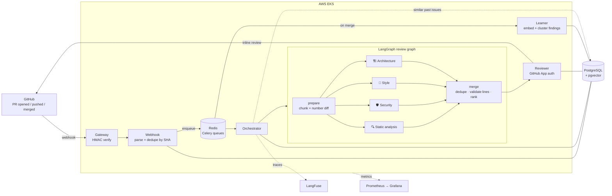

<div align="center">

# 🤖 GitHub PR AI Reviewer

**A GitHub App that reviews every pull request with four specialised AI agents running in parallel, posts inline comments on the exact changed lines, and learns each repository's recurring mistakes from merged PRs.**

[](https://github.com/AKHIL1633/github-pr-ai-reviewer/actions/workflows/tests.yml)


[How it works](#-how-it-works) · [Engineering highlights](#-engineering-highlights) · [Quick start](#-quick-start) · [Evaluation](#-evaluation) · [Production setup](docs/SETUP.md)

</div>

---

## ✨ What it does

Open a pull request and, within about a minute, the bot posts a review like this:

> ## 🤖 AI Code Review
>
> **5 findings** — 🔴 2 errors · 🟡 2 warnings · 🔵 1 info
>
> | Agent | 🔴 Error | 🟡 Warning | 🔵 Info |
> |---|:-:|:-:|:-:|
> | security | 2 | 0 | 0 |
> | static_analysis | 0 | 1 | 0 |
> | architecture | 0 | 1 | 0 |
> | style | 0 | 0 | 1 |

…and attaches each finding as an inline comment on the changed line:

> 🔴 **ERROR** · `security` — `src/users.py` line 6
>
> User input is interpolated directly into the SQL string, allowing SQL injection. Use a parameterised query: `cursor.execute("... WHERE username = %s", (username,))`.

<!-- Tip: replace the sample above with a screenshot of a real review: docs/images/review.png -->

- **4 agents in parallel**: static analysis, security (OWASP Top 10, secrets, injection), style, and architecture. They are orchestrated as a LangGraph fan-out/fan-in graph.
- **Comments land on the right line.** Diffs are pre-annotated with new-file line numbers, and findings are validated against the diff hunks before posting.
- **Learns per repository.** When a PR merges, its findings are embedded and clustered in **pgvector**. Future reviews retrieve the past issues most similar to the current diff and tell the agents to watch for them.
- **Production-grade pipeline**: HMAC-verified webhooks, idempotent processing per commit SHA, Celery/Redis queues with retries, 6 independently deployable services on **AWS EKS**, provisioned with **Terraform**.
- **Observable and measurable**: LangFuse traces for every LLM call, Prometheus/Grafana dashboards with custom review metrics, and a labelled benchmark that gates prompt changes in CI.

## 🏗 How it works



1. **Gateway** checks GitHub's `X-Hub-Signature-256` HMAC in constant time and rejects anything forged.
2. **Webhook** stores the PR, skips commits it has already seen (idempotent on `repo + PR + head SHA`), and enqueues the job. The HTTP response returns immediately (`202`), so GitHub never times out.
3. A **Celery worker** picks up the job (late-ack, automatic retries with backoff) and calls the **Orchestrator**.
4. The **Orchestrator** fetches the diff with a short-lived GitHub App installation token. It retrieves this repo's most relevant past issues from pgvector and runs the LangGraph review graph.
5. The **Reviewer** posts one GitHub review: a summary table plus inline comments. If GitHub rejects a comment position (for example after a force-push), it falls back to a summary-only review.
6. When the PR is **merged**, the **Learner** embeds the warnings and errors from that PR. Each one is merged into the nearest existing pattern (cosine distance < 0.2) or stored as a new pattern.

## 🔧 Engineering highlights

| Problem | Solution |
|---|---|
| LLMs miscount line numbers inside diff hunks, so inline comments land on the wrong line or get rejected by GitHub | `diff_utils.py` parses hunk headers and prefixes every line with its new-file number. Findings are checked against the set of commentable lines before posting. |
| Large PRs overflow the context window | The diff is split per file and packed into ~12k-character chunks. Each agent reviews all chunks concurrently with `asyncio.gather`. |
| Free-form LLM output breaks JSON parsing | JSON mode, plus a Pydantic schema that normalises severities (`HIGH` → `error`) and line formats (`"12-14"` → `12`). Malformed items are dropped individually instead of losing the whole response. |
| Running 4 agents one after another is slow | LangGraph `Send` fan-out with async nodes, so all agents (and all chunks) run in parallel. |
| Fan-in reducer duplicated every comment | Agents append to a reducer channel. The merge step writes to a separate `review` key, so de-duplicated output replaces rather than appends. |
| "Learning" by exact string match never matches anything, because LLM wording varies | Findings are embedded (`text-embedding-3-small`) and clustered in pgvector with an HNSW index. Retrieval ranks past issues by similarity to the current diff, then by frequency. |
| Duplicate deliveries and redeliveries from GitHub | Processing is idempotent per head SHA, Celery uses `acks_late` and retries with exponential backoff, and a failed review is marked `failed` in the DB. |
| Prompt changes can silently make reviews worse | A labelled benchmark with seeded bugs runs in CI and fails the build if recall drops below a threshold. |

## 🧰 Tech stack

| Layer | Tools |
|---|---|
| AI | LangGraph, OpenAI (`gpt-4o-mini`, `text-embedding-3-small`), Pydantic, LangFuse |
| Services | Python 3.11, FastAPI, Celery, Redis, SQLAlchemy (async), Alembic |
| Data | PostgreSQL 15 + pgvector (HNSW) |
| Infra | AWS EKS, RDS, ElastiCache, ECR, S3, ALB, Terraform, Kubernetes (HPA, Jobs) |
| CI/CD | GitHub Actions: per-service build → ECR → rolling deploy, OIDC auth to AWS (no static keys) |
| Observability | Prometheus, Grafana, LangFuse, custom metrics (`pr_review_duration_seconds`, `pr_review_findings_total`) |
| Quality | pytest (all services), labelled review benchmark, RAGAS faithfulness job |

## 🚀 Quick start

### 1. Review a local diff (about 2 minutes, only needs an OpenAI key)

```bash
pip install -r services/orchestrator/requirements.txt
export OPENAI_API_KEY=sk-...

git diff main | python scripts/review_local.py
python scripts/review_local.py --diff my.patch --json
python scripts/review_local.py --diff my.patch --fail-on error   # use as a pre-commit / CI gate
```

### 2. Run the whole system locally with Docker Compose

```bash
cp .env.example .env          # add your OpenAI key and GitHub App credentials
docker compose up --build     # Postgres+pgvector, Redis, migrations, 5 services, 2 workers
docker compose --profile monitoring up   # optional: Prometheus :9090, Grafana :3000
```

To receive real webhooks locally, forward them with [smee.io](https://smee.io):
`npx smee-client --url https://smee.io/<channel> --target http://localhost:8000/webhook/github`

### 3. Deploy to AWS

[docs/SETUP.md](docs/SETUP.md) walks through Terraform → EKS → GitHub App → monitoring, end to end.

## 📊 Evaluation

`eval/cases/` contains small source files with **seeded bugs**: SQL and command injection, path traversal, hardcoded secrets, insecure deserialisation, swallowed exceptions, mutable defaults, unused variables and tangled responsibilities. There is also a clean control file. Each bug is labelled with a `# expect: <agent>` marker, which is stripped before review so the model never sees the labels.

```bash
python scripts/benchmark.py                   # recall, false positives, latency
python scripts/benchmark.py --min-recall 0.75 # what CI runs on prompt changes
```

<!-- Paste your latest benchmark output here, e.g.
| Metric | Result |
|---|---|
| Recall on seeded issues | xx% (n/10) |
| False positives on clean code | n |
| Median review latency | x.x s |
-->

## 🧪 Tests

```bash
cd services/orchestrator && pip install -r requirements.txt pytest && pytest -q
```

Every service has its own suite. The tests cover HMAC verification (forged, tampered and valid payloads), diff parsing and line mapping, chunking, LLM output validation, graph fan-out and merge, review formatting, and queue routing. They run on every push through `.github/workflows/tests.yml`.

## 📁 Project structure

```
services/
  gateway/        HMAC verification, forwards to webhook
  webhook/        event parsing, idempotency, Celery producer + worker
  orchestrator/   GitHub diff fetch, pattern retrieval, LangGraph agents (graph.py, diff_utils.py)
  reviewer/       GitHub App auth, review formatting + posting
  learner/        embeds merged-PR findings, clusters them into repo patterns
db/migrations/    Alembic (schema, pgvector column + HNSW index)
infra/terraform/  VPC, EKS, RDS, ElastiCache, ECR, S3, IAM
infra/k8s/        Deployments, Services, HPA, Ingress, migration + eval Jobs
monitoring/       Prometheus scrape config, Grafana dashboard
scripts/          review_local.py, benchmark.py, evaluate.py (RAGAS)
eval/cases/       labelled benchmark cases
```

## 🗺 Roadmap

- [ ] Suggested-change blocks (`suggestion` syntax) so fixes are one click
- [ ] Learn from developer reactions (👍/👎 on comments) to suppress noisy finding types
- [ ] Per-repo config file (`.ai-reviewer.yml`) for enabled agents and severity threshold
- [ ] Support for self-hosted / open-weight models

## 🙏 Acknowledgements

Built on top of the [GitHub PR Code AI Reviewer](https://github.com/data-guru0/GitHub-PR-Code-AI-Reviewer) project by data-guru0. Extended with semantic pattern learning (pgvector), diff-aware line mapping and chunking, schema-validated agent output, async parallel execution, test suites, a labelled benchmark with a CI gate, a local CLI, Docker Compose, and several reliability fixes.
